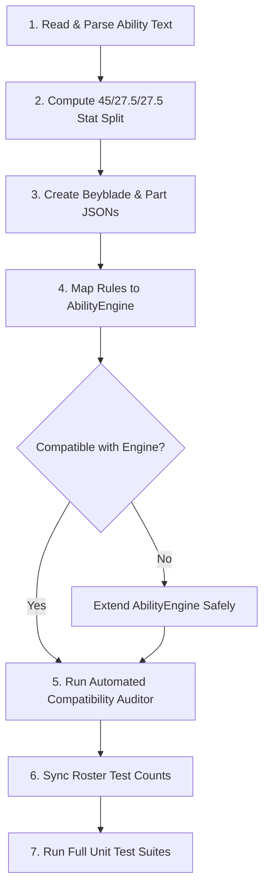

# Beyblade Compatibility & Ability Engine Auditor

Use this skill whenever:
1. Adding or modifying a Beyblade definition (`beys/*.json`).
2. Creating default modular components (`parts/disks/*.json`, `parts/drivers/*.json`).
3. Translating user-provided or human-written abilities/passives/specials into `AbilityEngine` rules.
4. Verifying engine compatibility or safely extending `cogs/abilities/ability_engine.py`.
5. Synchronizing roster test assertions across test suites (`tools/test_*.py`).

---

## Step-by-Step Authoring & Validation Workflow



---

## 1. Carefully Reading Abilities to Understand Effects

When users provide new Beyblades, their abilities often mix thematic narrative with raw RPG mechanics.

Follow the **Trigger $\rightarrow$ Condition $\rightarrow$ Operation** protocol:
- **Trigger**: Identify *when* the effect happens:
  - On attack hit $\rightarrow$ `"when": "on_attack_hit"`
  - Below HP threshold $\rightarrow$ `"when": "on_low_hp"` with `"if": [{"cond": "hp_below_pct", "value": X}]`
  - On final hit of multi-hit special $\rightarrow$ `"when": "on_special_last_hit"`
- **Condition**: Identify *restrictions*:
  - Percent chance $\rightarrow$ `"chance": 0.25`
  - Once per match $\rightarrow$ `"once": "battle"`
  - Turn cooldown $\rightarrow$ `"cooldown": 3`
- **Operations**: Identify the *concrete math & state changes*:
  - Bonus damage scaling from a stat $\rightarrow$ `"op": "bonus_damage_stat"`
  - Healing $\rightarrow$ `"op": "heal"` or `"heal_pct"`
  - Costing stamina $\rightarrow$ `"op": "consume_stamina"`
  - Zeroing/transferring stats $\rightarrow$ `"op": "stat_transfer"`
  - Permanent defense shred $\rightarrow$ `"op": "shatter"`

> [!TIP]
> For a full list of all 30+ supported triggers, conditions, and operations with examples, consult [ability_effects_guide.md](./references/ability_effects_guide.md).

---

## 2. Component Split Calculation (45% / 27.5% / 27.5%)

Every Beyblade in Betcord must be split across three physical parts using the authorized largest-remainder tie-break (`frame`, `disk`, `driver`):
- **Main Frame**: 45.0%
- **Default Disk**: 27.5%
- **Default Driver**: 27.5%

You can calculate this automatically using the bundled helper script:
```powershell
py .agents/skills/beyblade-compatibility-auditor/scripts/check_beyblade_compatibility.py --compute-split <HP> <ATK> <DEF> <STM>
```

---

## 3. Creating Part Definitions

When registering `BB<N>`:
1. `beys/<blade_name>.json`:
   - Set `"id": "BB<N>"`, `"name": "<Name>"`, `"rarity"`, `"type"`, `"spin_direction"`, `"generation"`.
   - Set `"main_frame"`, `"default_parts": {"disk": "BB<N>_default_disk", "driver": "BB<N>_default_driver"}`.
   - Set `"special_move"` with `hits`, `damage_per_hit`, `total_damage` (sum of hits must equal `total_damage` and `stats.special`).
2. `parts/disks/BB<N>_default_disk.json`:
   - Set ID, matching rarity, stats from disk split, price ($1000 \times \text{rarity\_mult}$), sell value.
3. `parts/drivers/BB<N>_default_driver.json`:
   - Set ID, matching rarity, stats from driver split, price, sell value.

---

## 4. Safely Extending `AbilityEngine` (If Needed)

If an ability requires a trigger or effect not yet in `AbilityEngine`:
1. **Never break existing mechanics**: Extend by adding new branches to `TRIGGERS` or `_run_ops`.
2. **Defensive Programming**: Wrap all op logic in `try ... except Exception`.
3. **Add New Trigger**:
   - Add trigger name to `TRIGGERS` in [ability_engine.py](file:///e:/GITHUB%20BETCORD/cogs/abilities/ability_engine.py).
   - Dispatch it in `apply()` or `_fire()`.
4. **Add New Op**:
   - Add `elif kind in ("my_new_op",):` in `_run_ops`.
   - Support `label`, `turns`, `emoji`, and battle log output.

---

## 5. Automated Compatibility Auditor

Run the automated verification script to validate schema, math, parts, abilities, and engine triggers:

```powershell
# Audit a single Beyblade
py .agents/skills/beyblade-compatibility-auditor/scripts/check_beyblade_compatibility.py --bey <ID_or_Name> --verbose

# Audit the entire roster
py .agents/skills/beyblade-compatibility-auditor/scripts/check_beyblade_compatibility.py --all
```

The script verifies:
- JSON syntax and required schema keys.
- Part existence in `parts/disks/` and `parts/drivers/`.
- Exact sum match: `frame + disk + driver == total_stat` for all 4 stats.
- Special move hit damage array matches total damage.
- Ability triggers are recognized in `AbilityEngine.TRIGGERS`.
- Ability operations are recognized in `AbilityEngine` / `EXTENDED_OPS` / `TACTICAL_OPS` / `GIMMICK_OPS`.

---

## 6. Roster Test Synchronization Checklist

Whenever a new Beyblade is added, update the hardcoded counts in these 6 test files to match the new total:

1. `tools/test_character_components.py`:
   - Add `'BB<N>': '<Name>'` to additions mapping.
   - Update `(('beys', N), ('avatars', 59), ('parts/disks', D), ('parts/drivers', R))`
2. `tools/test_physical_components.py`:
   - Update `self.assertEqual(len(beys), N)`
3. `tools/test_special_avatar_pipeline.py`:
   - Update `self.assertEqual(len(blades), N)`
4. `tools/test_blast_jinnius.py`:
   - Update `self.assertEqual(len(load_beys()), N)`
5. `tools/test_dragon_killer_black_legend.py`:
   - Update `self.assertEqual(len(load_beys()), N)`
6. `tools/test_roster_refresh.py`:
   - Update `N-1`, `N`, and `"N Beys"` descriptions.

Verify all 61 tests pass:
```powershell
py -m unittest tools.test_physical_components tools.test_character_components tools.test_blast_jinnius tools.test_dragon_killer_black_legend tools.test_roster_refresh tools.test_special_avatar_pipeline
```
