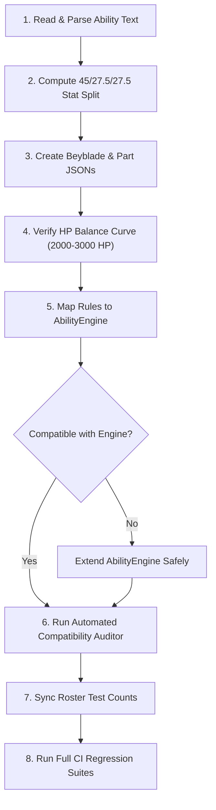

# Beyblade Compatibility & Ability Engine Auditor

Use this skill whenever:
1. Adding or modifying a Beyblade definition (`beys/*.json`).
2. Creating default modular components (`parts/disks/*.json`, `parts/drivers/*.json`).
3. Translating user-provided or human-written abilities/passives/specials into `AbilityEngine` rules.
4. Verifying engine compatibility or safely extending `cogs/abilities/ability_engine.py`.
5. Ensuring HP balance curve and level-100 stock HP constraints ($2,000 \le \text{HP} \le 3,000$).
6. Synchronizing roster test assertions across test suites (`tools/test_*.py`).
7. Pre-flighting CI regression suites before opening a Pull Request.

---

## Step-by-Step Authoring & Validation Workflow



---

## 1. Carefully Reading Abilities to Understand Effects

When users provide new Beyblades, their abilities often mix thematic narrative with raw RPG mechanics.

Follow the **Trigger $\rightarrow$ Condition $\rightarrow$ Operation** protocol:
- **Trigger**: Identify *when* the effect happens:
  - On attack hit $\rightarrow$ `"when": "on_attack_hit"`
  - Below HP threshold $\rightarrow$ `"when": "on_low_hp"` with `"if": [{"cond": "hp_below_pct", "value": X}]`
  - On final hit of multi-hit special $\rightarrow$ `"when": "on_special_last_hit"`
  - On receiving damage $\rightarrow$ `"when": "on_take_damage"`
  - On would burst $\rightarrow$ `"when": "on_would_burst"`
- **Condition**: Identify *restrictions*:
  - Percent chance $\rightarrow$ `"chance": 0.25`
  - Once per match $\rightarrow$ `"once": "battle"`
  - Turn cooldown $\rightarrow$ `"cooldown": 3`
- **Operations**: Identify the *concrete math & state changes*:
  - Bonus damage scaling from a stat $\rightarrow$ `"op": "bonus_damage_stat"`
  - Healing $\rightarrow$ `"op": "heal"` or `"heal_pct"`
  - Costing stamina $\rightarrow$ `"op": "consume_stamina"`
  - Zeroing/transferring stats $\rightarrow$ `"op": "stat_transfer"`
  - Permanent defense shred $\rightarrow$ `"op": "shatter"`
  - Form transform / sprite swap $\rightarrow$ `"op": "evolve_form"`

> [!TIP]
> For a full list of all 30+ supported triggers, conditions, and operations with examples, consult [ability_effects_guide.md](./references/ability_effects_guide.md).

---

## 2. Component Split Calculation (45% / 27.5% / 27.5%)

Every Beyblade in Betcord must be split across three physical parts using the authorized largest-remainder tie-break (`frame`, `disk`, `driver`):
- **Main Frame**: 45.0%
- **Default Disk**: 27.5%
- **Default Driver**: 27.5%

You can calculate this automatically using the bundled helper script:
```powershell
py .agents/skills/beyblade-compatibility-auditor/scripts/check_beyblade_compatibility.py --compute-split <HP> <ATK> <DEF> <STM>
```

---

## 3. HP Balance & Level-100 Stock Ceiling Rule ($2,000 \le \text{HP} \le 3,000$)

> [!IMPORTANT]
> GitHub Actions CI strictly enforces this rule in `tools/test_hp_balance.py` (`isolated-regressions` job). If any stock Beyblade exceeds 3,000 HP or falls below 2,000 HP at level 100, CI checks will fail!

### Balance Requirements
1. **Stock Level-100 Bounds**:
   For every official Beyblade, across IV 0 and IV 10 (max IV), battle HP must strictly satisfy:
   $$2,000 \le \text{Battle HP}_{\text{Lv 100}} \le 3,000$$
2. **Monotonicity**:
   HP must strictly increase with each level from 1 to 100.
3. **High Base HP (> 100) Handling**:
   - In Betcord, baseline Beys typically have base HP between 70 and 100.
   - If a new Bey is authored with base HP > 100 (e.g., Galactic Astral with 144 HP, Prime Whisper with 150 HP), [utils/bey_levels.py](file:///e:/GITHUB%20BETCORD/utils/bey_levels.py) caps base HP at `HP_STAT_MAX` (100) for level progression calculations:
     ```python
     calc_hp_base = min(base["hp"], HP_STAT_MAX)
     ```
   - This ensures level 1 battles use the full authored base HP, while level-100 progression stays under the 3,000 HP balance ceiling.

---

## 4. Creating Part Definitions

When registering `BB<N>`:
1. `beys/<blade_name>.json`:
   - Set `"id": "BB<N>"`, `"name": "<Name>"`, `"rarity"`, `"type"`, `"spin_direction"`, `"generation"`.
   - Set `"main_frame"`, `"default_parts": {"disk": "BB<N>_default_disk", "driver": "BB<N>_default_driver"}`.
   - Set `"special_move"` with `hits`, `damage_per_hit`, `total_damage` (sum of hits must equal `total_damage` and `stats.special`).
2. `parts/disks/BB<N>_default_disk.json`:
   - Set ID, matching rarity, stats from disk split, price ($1000 \times \text{rarity\_mult}$), sell value.
3. `parts/drivers/BB<N>_default_driver.json`:
   - Set ID, matching rarity, stats from driver split, price, sell value.

---

## 5. Safely Extending `AbilityEngine` (If Needed)

If an ability requires a trigger or effect not yet in `AbilityEngine`:
1. **Never break existing mechanics**: Extend by adding new branches to `TRIGGERS` or `_run_ops`.
2. **Defensive Programming**: Wrap all op logic in `try ... except Exception`.
3. **Add New Trigger**:
   - Add trigger name to `TRIGGERS` in [ability_engine.py](file:///e:/GITHUB%20BETCORD/cogs/abilities/ability_engine.py).
   - Dispatch it in `apply()` or `_fire()`.
4. **Add New Op**:
   - Add `elif kind in ("my_new_op",):` in `_run_ops`.
   - Support `label`, `turns`, `emoji`, and battle log output.

---

## 6. Automated Compatibility Auditor

Run the automated verification script to validate schema, math, parts, abilities, HP balance, and engine triggers:

```powershell
# Audit a single Beyblade
py .agents/skills/beyblade-compatibility-auditor/scripts/check_beyblade_compatibility.py --bey <ID_or_Name> --verbose

# Audit the entire roster
py .agents/skills/beyblade-compatibility-auditor/scripts/check_beyblade_compatibility.py --all
```

The script verifies:
- JSON syntax and required schema keys.
- Part existence in `parts/disks/` and `parts/drivers/`.
- Exact sum match: `frame + disk + driver == total_stat` for all 4 stats.
- **HP Balance Curve & Level-100 Cap**: Verifies $2,000 \le \text{HP} \le 3,000$ and monotonic growth across levels 1 to 100 for IV 0 and IV 10.
- Special move hit damage array matches total damage.
- Ability triggers are recognized in `AbilityEngine.TRIGGERS`.
- Ability operations are recognized in `AbilityEngine` / `EXTENDED_OPS` / `TACTICAL_OPS` / `GIMMICK_OPS`.
- **Roster & HP Balance Test Execution**: Executes `tools/test_hp_balance.py` automatically to guarantee CI parity.

---

## 7. Roster Test Synchronization Checklist

Whenever a new Beyblade is added, update the hardcoded counts in these 6 test files to match the new total:

1. `tools/test_character_components.py`:
   - Add `'BB<N>': '<Name>'` to additions mapping.
   - Update `(('beys', N), ('avatars', 59), ('parts/disks', D), ('parts/drivers', R))`
2. `tools/test_physical_components.py`:
   - Update `self.assertEqual(len(beys), N)`
3. `tools/test_special_avatar_pipeline.py`:
   - Update `self.assertEqual(len(blades), N)`
4. `tools/test_blast_jinnius.py`:
   - Update `self.assertEqual(len(load_beys()), N)`
5. `tools/test_dragon_killer_black_legend.py`:
   - Update `self.assertEqual(len(load_beys()), N)`
6. `tools/test_roster_refresh.py`:
   - Update `N-1`, `N`, and `"N Beys"` descriptions.

---

## 8. CI Pre-Flight Verification Before Opening PR

Before committing and pushing to a PR branch, run the core CI test suite:

```powershell
py -m unittest tools.test_character_components tools.test_physical_components tools.test_hp_balance tools.test_special_avatar_pipeline tools.test_blast_jinnius tools.test_dragon_killer_black_legend tools.test_roster_refresh
```

After pushing, monitor the GitHub Actions check status with:
```powershell
gh pr checks <PR_NUM>
```
